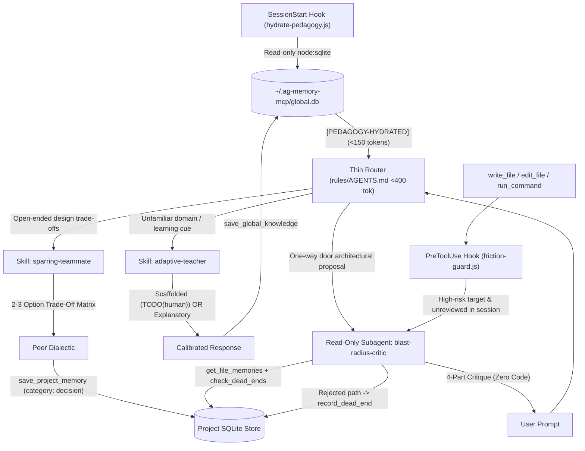

# Cognitive Personas

> **Cross-Harness Cognitive Persona Framework & Best-Practices Playbook** paired with an installable **Antigravity Reference Plugin**.

[](LICENSE)
[]()
[]()
[]()

---

## 1. Problem: "Vibe Coding" & Comprehension Debt

Autonomous AI coding agents make developers dramatically faster at shipping code, but introduce silent cognitive failure modes:
1. **Comprehension Debt:** Approving large AI diffs without understanding their invariants makes systems brittle and impossible to debug during production outages.
2. **RLHF Sycophancy:** Models default to flattering the user, validating flawed architectures and nodding along to dangerous, irreversible operations.
3. **Ceremony Fatigue:** Rigid review bots that nag on every single CSS tweak or unit test cause developers to uninstall them in frustration.

**Cognitive Personas** solves this through **Constraint-Over-Roleplay**: procedural transformations that calibrate pedagogical scaffolding and gate high-blast-radius actions with zero fluff.

---

## 2. The Cognitive Triad

```
                      [ Human Developer ]
                               ▲
                               │
            ┌──────────────────┼──────────────────┐
            ▼                  ▼                  ▼
     Adaptive Teacher    Sparring Teammate   Blast-Radius Critic
     (Stateful Growth)   (Design Dialectic)  (Falsification Gate)
```

| Persona | Purpose | Invariant Trigger | Interaction Style |
| :--- | :--- | :--- | :--- |
| **Adaptive Teacher** | Closes comprehension debt | Domain mastery in `Novice`/`Developing` | **Scaffolded** (`TODO(human)`) or **Explanatory** (ship-first with mental models). |
| **Blast-Radius Critic** | Prevents catastrophic failure | Database migrations, auth/crypto, contract breaks | **4-Part Critique** (Fatal Flaw, Assumptions, Invariant Conflicts, Questions) with **zero code** and **zero praise**. |
| **Sparring Teammate** | Synthesizes sound design | Open-ended architectural choices | **2–3 Option Trade-Off Matrix** + decisive peer recommendation + ADR logging. |

---

## 3. Architecture & Runtime Flow



---

## 4. Repository Structure

```text
cognitive-personas/
├── spec/                         # Harness-agnostic core standards
│   ├── persona-protocol.md       # Constraint-over-roleplay behavioral contracts
│   ├── pedagogy-rubric.md        # 3-tier mastery rubric & posture transitions
│   ├── blast-radius-taxonomy.md  # Deterministic + semantic reversibility triggers
│   └── agent-memory-v3.2-spec.md # Proposed native MCP schema/tool extensions
├── docs/                         # Framework Playbook & Guides
│   ├── design-spec.md            # Validated architecture specification
│   ├── playbook.md               # Practical guide, cognitive science & anti-patterns
│   ├── ecosystem-guide.md        # Composing with Superpowers, BMAD, gstack, agent-memory
│   └── bonus-personas.md         # Templates: Archaeologist, Rubber Duck, YAGNI Skeptic
├── adapters/                     # Drop-in configs for external harnesses
│   ├── claude-code/              # Claude Code output styles & CLAUDE.md
│   ├── cursor/                   # Cursor IDE .mdc rules
│   ├── roo-code/                 # Roo Code custom modes (.roomodes)
│   └── copilot/                  # GitHub Copilot chat modes (.chatmode.md)
├── plugin/                       # Installable Antigravity Reference Plugin
│   ├── plugin.json               # Plugin manifest
│   ├── hooks.json                # SessionStart and PreToolUse hook registrations
│   ├── scripts/
│   │   ├── hydrate-pedagogy.js   # SessionStart: read-only global.db summary (<50ms)
│   │   └── friction-guard.js     # PreToolUse: blast-radius gate + session dedupe
│   ├── rules/
│   │   └── AGENTS.md             # <400-token semantic router
│   └── skills/                   # On-demand progressive skills
│       ├── adaptive-teacher/
│       ├── blast-radius-critic/
│       └── sparring-teammate/
└── tests/                        # Zero-dependency node:test suite
    ├── helpers.js
    ├── hydrate-pedagogy.test.js
    ├── friction-guard.test.js
    └── plugin-structure.test.js
```

---

## 5. Prerequisites & Dependency Model

| Requirement | Type | Purpose | Behavior if Missing |
| :--- | :--- | :--- | :--- |
| **Node.js v22+** | Runtime | Native `node:sqlite`, `node:test`, `node:fs` | Required for lifecycle hook scripts. |
| **npm Packages** | Package Dependencies | **0 dependencies** (no `node_modules` required) | Standard library only; zero package bloat. |
| **agent-memory-mcp** | Companion MCP Server | Cross-session mastery (`global.db`) & ADR persistence | **Optional (Fails Open)**: If absent or uninstalled, all hooks and personas continue operating seamlessly in stateless in-session mode without errors. |

---

## 6. Quickstart & Installation

### Google Antigravity
To install the reference plugin into your local Antigravity environment:
```bash
npm run sync-plugin
```
*Requires Node.js v22+ (v24 recommended) with native `node:sqlite` support.*

### Claude Code
Copy `adapters/claude-code/.claude` into your project root and select styles via `/output-style <persona>`.

### Cursor
Copy `adapters/cursor/.cursor` into your workspace root. `blast-radius-critic.mdc` automatically gates sensitive file globs.

### Roo Code
Copy `adapters/roo-code/.roomodes` into your workspace root and pick your active mode from the dropdown.

### GitHub Copilot
Copy `adapters/copilot/.github` into your project root and invoke participants in VS Code Copilot Chat.

---

## 6. Testing & Verification

Run the zero-dependency test suite via Node.js native test runner:

```bash
npm test
```

Run manifest and structural integrity checks:

```bash
npm run lint-structure
```

---

## 7. License

MIT License. See [LICENSE](LICENSE) for details.
