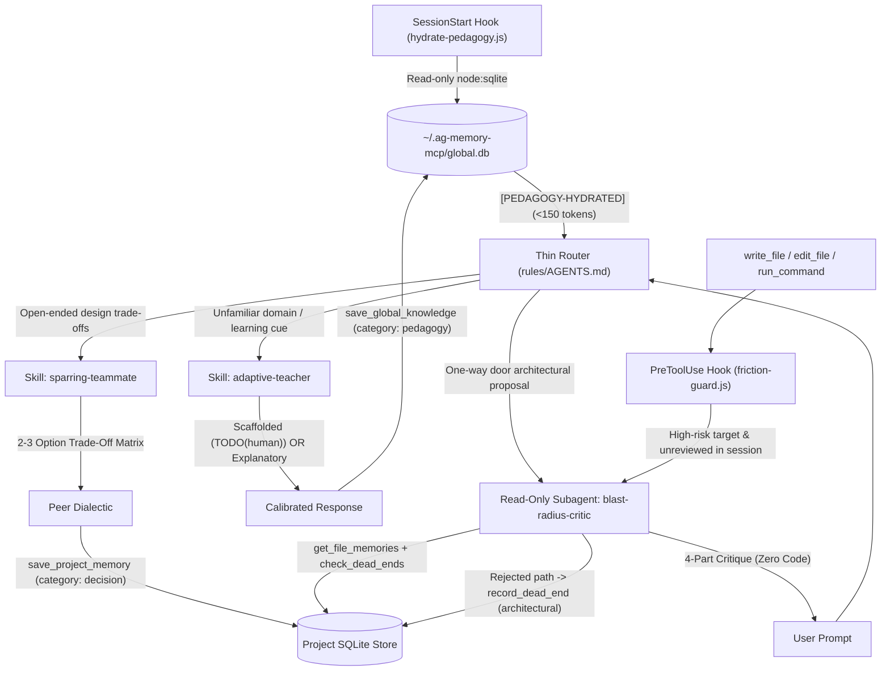

# Cognitive Personas — Validated Design Specification

> **Status:** Validated via `/brainstorming`  
> **Date:** 2026-11-07  
> **Repository Root:** `D:/Media/Projects/cognitive-personas`  
> **Target Plugin Name:** `cognitive-personas`

---

## 1. Understanding Summary

* **What is being built:** A **Cross-Harness Cognitive Persona Framework & Best-Practices Playbook** paired with an installable **Antigravity Reference Plugin** (`cognitive-personas`) featuring three human-in-the-loop personas:
  1. **Adaptive Teacher (`adaptive-teacher`):** Stateful pedagogy backed by `~/.ag-memory-mcp/global.db` across three mastery tiers (`Novice`, `Developing`, `Proficient`) and two user-selectable postures (**Scaffolded / Hands-On** and **Explanatory / Ship-First**).
  2. **Blast-Radius Critic (`blast-radius-critic`):** Adaptive friction routing combining deterministic `PreToolUse` lifecycle guards (`hooks.json`) with upstream semantic rule triage and hardware-enforced read-only subagent isolation.
  3. **Sparring Teammate (`sparring-teammate`):** On-demand dialectic thought partner for weighing architectural trade-offs before implementation and logging Architecture Decision Records (ADRs) to project memory.
* **Framework & Ecosystem Deliverables:** Portable specifications (`spec/`), best-practice documentation and community interoperability guides (`docs/` covering Superpowers, BMAD, gstack, and bonus archetypes), drop-in adapters (`adapters/` for Claude Code, Cursor, Roo Code, and GitHub Copilot), and an optional `agent-memory-mcp` v3.2 native schema/tool extension specification.
* **Why it exists:** To counter cognitive offloading ("vibe coding" comprehension debt) and RLHF sycophancy without inflicting always-on ceremony fatigue during routine coding.
* **Who it is for:** Engineers using agentic coding tools who want adaptive domain mentorship, structured trade-off sparring, and automated pushback on high-blast-radius / irreversible changes.
* **Key constraints:** Zero runtime or schema modifications to `agent-memory-mcp` v3.1 in the v1 plugin—all persistence layers cleanly onto existing `agent-memory-mcp` tools.
* **Explicit non-goals:**
  * Forking or mutating the live `agent-memory-mcp` v3.1 server codebase in Phase 1.
  * Multi-agent autonomous role-play theater (every persona exists strictly to inform and challenge the *human* developer).
  * Verbose, always-on commentary on routine, reversible edits.

---

## 2. Assumptions & Non-Functional Requirements

* **Performance:** Lifecycle hook scripts (`hydrate-pedagogy.js`, `friction-guard.js`) execute in `< 150ms` (`< 50ms` target for SQLite read hydration) via zero-dependency Node.js (`node --no-warnings` + `node:sqlite`). Always-on `rules/AGENTS.md` stays strictly `< 400 tokens`, delegating full behavioral contracts to progressive `skills/`.
* **Scale:** Local single-developer workstation scale (hundreds of cross-project `pedagogy` nodes in `~/.ag-memory-mcp/global.db`; tens to hundreds of file-anchored architectural invariants and dead-ends per project DB).
* **Security & Privacy:** 100% local-first persistence inside `~/.ag-memory-mcp/`; zero network calls or external telemetry; Critic subagent runs strictly read-only (`EnableWriteTools: false`).
* **Reliability & Graceful Degradation:** Hooks **fail open**—any runtime error, `SQLITE_BUSY` lock, missing `global.db`, or disabled `agent-memory-mcp` server falls back cleanly to stateless session behavior (`{}` on `SessionStart`, `{"decision": "allow"}` on `PreToolUse`).
* **Maintenance & Ownership:** Maintained at `D:/Media/Projects/cognitive-personas` as a standalone Git repository, deploying `plugin/` into `~/.gemini/config/plugins/cognitive-personas/`.

---

## 3. Key Risks & Mitigations

| Risk | Impact | Mitigation |
| :--- | :--- | :--- |
| **Ceremony / Nag Fatigue** | Developer disables plugin if Critic fires repeatedly during multi-file refactors. | Session deduplication marker in `os.tmpdir()` keyed by `(conversationId, riskCategory)` ensures each risk category prompts at most once per conversation. |
| **RLHF Persona Drift** | Over long sessions, Critic softens into agreement or Teacher dumps full code prematurely. | Enforce **procedural output contracts** over theatrical role-play; isolate Critic in a fresh-context read-only subagent; bind Teacher postures to explicit rules. |
| **Socratic Frustration Loops** | Developer gets blocked on a `TODO(human)` task under a tight deadline. | Built-in `"just ship"` instant bypass + 2-strike frustration circuit breaker that transitions from Socratic hints to concrete worked examples. |
| **Hook Deadlocks / Latency** | Broken hook script stalls every agent tool call. | Strict `5s` timeout in `hooks.json`, zero external npm dependencies, and top-level `try/catch` fail-open wrappers. |
| **Missing `agent-memory-mcp`** | Users in other harnesses or fresh installs lack `~/.ag-memory-mcp/global.db`. | Stateless session fallback + optional `.agents/pedagogy-profile.md` local file fallback documented in portable adapters. |

---

## 4. Decision Log

| ID | Decision | Alternatives Considered | Why Chosen |
| :--- | :--- | :--- | :--- |
| **D1** | **Cross-Harness Framework + Antigravity Reference Plugin** | Antigravity-only plugin; direct merge into `agent-memory`; docs-only | Delivers portable value across IDEs while proving the design with a runnable Antigravity + `agent-memory-mcp` implementation. |
| **D2** | **Hybrid `agent-memory-mcp` Integration (v3.1 Layering + v3.2 Spec)** | Zero-change only; immediate server fork/schema change | Works out-of-the-box with `agent-memory-mcp` v3.1 without coupling releases, while specifying clean native MCP tools for v3.2. |
| **D3** | **Hybrid Friction Routing (`hooks.json` + Semantic Rule Triage)** | Pure prompt/rule routing; pure file-glob hook routing | Hooks guarantee deterministic catches on sensitive files/commands; semantic triage catches flawed architecture early in chat. |
| **D4** | **Dual User-Selectable Pedagogy Postures (Scaffolded + Explanatory)** | Scaffolded-only; Explanatory-only; post-hoc notes only | Supports both hands-on `TODO(human)` skill building and deadline-friendly full code with mastery-calibrated explanations. |
| **D5** | **Bundle `Sparring Teammate` as 3rd Executable Plugin Skill** | Docs/template-only in v1 | Completes the core human-in-the-loop triad (*Teacher*, *Critic*, *Teammate*) directly inside the Reference Plugin. |
| **D6** | **Name Project & Plugin `cognitive-personas`** | Custom naming alternatives | Clear, descriptive, and avoids namespace collisions with existing plugins. |
| **D7** | **Approach 1: Thin Router + Progressive Skills + Subagent Critic** | Hook-heavy state machine; dedicated companion MCP server | Preserves `<400-token` rule budget, enforces read-only Critic via subagent permissions, and avoids duplicate MCP daemons (**YAGNI**). |
| **D8** | **Canonical Repo Path at `D:/Media/Projects/cognitive-personas`** | `~/.gemini/antigravity/scratch/`; live `~/.gemini/config/plugins/` | First-class Git repo location accessible across all editors and clean for GitHub publishing. |

---

## 5. Final Architecture & Component Design

### 5.1 Repository Structure

```text
D:/Media/Projects/cognitive-personas/
├── README.md
├── package.json                  # Zero-dep scripts: test, lint-structure, sync-plugin
├── spec/                         # Harness-agnostic core standards
│   ├── persona-protocol.md       # Constraint-over-roleplay behavioral contracts
│   ├── pedagogy-rubric.md        # 3-tier mastery rubric & posture state transitions
│   ├── blast-radius-taxonomy.md  # Deterministic + semantic reversibility triggers
│   └── agent-memory-v3.2-spec.md # Proposed native MCP schema/tool extensions
├── docs/                         # Framework & Best-Practices Playbook
│   ├── design-spec.md            # This validated design specification
│   ├── playbook.md               # Practical guide, cognitive science & anti-patterns
│   ├── ecosystem-guide.md        # Composing with Superpowers, BMAD, gstack, etc.
│   └── bonus-personas.md         # Templates: Archaeologist, Rubber Duck, YAGNI Skeptic
├── adapters/                     # Drop-in configs for external harnesses
│   ├── claude-code/              # .claude/output-styles/*.md + CLAUDE.md snippet
│   ├── cursor/                   # .cursor/rules/*.mdc
│   ├── roo-code/                 # .roomodes custom mode definitions
│   └── copilot/                  # .github/chatmodes/*.chatmode.md
├── plugin/                       # Installable Antigravity Reference Plugin
│   ├── plugin.json
│   ├── README.md
│   ├── hooks.json
│   ├── assets/logo.svg
│   ├── scripts/
│   │   ├── hydrate-pedagogy.js   # SessionStart: read-only global.db summary (<50ms)
│   │   └── friction-guard.js     # PreToolUse: high-blast-radius gate + session dedupe
│   ├── rules/
│   │   └── AGENTS.md             # <400-token router
│   └── skills/
│       ├── adaptive-teacher/SKILL.md
│       ├── blast-radius-critic/SKILL.md
│       └── sparring-teammate/SKILL.md
└── tests/                        # node --test verification suite
    ├── hydrate-pedagogy.test.js
    ├── friction-guard.test.js
    └── plugin-structure.test.js
```

### 5.2 Runtime Data Flow



### 5.3 Stateful Adaptive Pedagogy (`adaptive-teacher`)
* **`global.db` Convention:** Uses `save_global_knowledge` / `search_global_knowledge` with `category: "pedagogy"`, `tech_stack: "<domain>"`, and `title: "Mastery: <domain>/<concept>"`. Body stores structured fields: `tier` (`Novice` | `Developing` | `Proficient`), `default_posture` (`scaffolded` | `explanatory`), `signals`, and noted misconceptions.
* **Posture Matrix:**
  * **Scaffolded (`Hands-On`):** `Novice` receives boilerplate + guided `TODO(human)` markers + Socratic hint ladder; `Developing` receives complete code + concise pattern rationale + 1 comprehension check; `Proficient` receives silent execution.
  * **Explanatory (`Ship-First`):** Always emits complete runnable code, scaling the appended explanation (`Novice` mental-model deep dive → `Developing` brief trade-off note → `Proficient` none) with optional end-of-task mastery checkpoints.
* **Controls:** Instant `"just ship"` bypass and a 2-attempt frustration circuit breaker.

### 5.4 Adaptive Friction Routing (`blast-radius-critic` & `sparring-teammate`)
* **Two-Layer Detection:**
  1. *Semantic Triage (`AGENTS.md`):* Catches upstream architectural proposals (migrations, auth/crypto, new dependencies, breaking API contracts) in chat before code is written.
  2. *Deterministic Guard (`friction-guard.js`):* Matches `PreToolUse` calls on `write_file|edit_file|run_command` against sensitive globs (`**/migrations/**`, `**/auth/**`, `package.json`, `Cargo.toml`, `schema.prisma`, `openapi.*`, destructive shell flags) with per-session `(conversationId, riskCategory)` deduplication in `os.tmpdir()`.
* **Isolated Read-Only Critic:** Runs inside a read-only subagent (`research` / `EnableWriteTools: false`), grounded via `get_file_memories` and `check_dead_ends` (`kind: "architectural"`). Outputs strictly: **(1) Fatal Flaw**, **(2) Unstated Assumptions**, **(3) Project Invariant Conflicts**, and **(4) 1–2 Stress-Test Questions**—with zero praise and zero implementation code.
* **Sparring Teammate:** Activates on exploratory trade-off prompts; builds a **2–3 Option Trade-Off Matrix** (*Simplicity vs. Scale vs. Reversibility*), debates with an explicit peer recommendation, and records settled decisions via `save_project_memory` (`category: "decision"`).

### 5.5 Verification & Testing
* Automated `node --test` suite validating:
  * `hydrate-pedagogy.js` against populated, empty, locked, and missing SQLite DB fixtures (`<50ms` assertion).
  * `friction-guard.js` stdin/stdout payloads across benign edits, high-blast-radius paths/commands, session-marker deduplication, 24h stale-marker pruning, and malformed-JSON fail-open behavior.
  * Manifest and token-budget integrity (`plugin.json`, `hooks.json`, valid `SKILL.md` YAML frontmatter, and `AGENTS.md` `< 400 tokens`).
